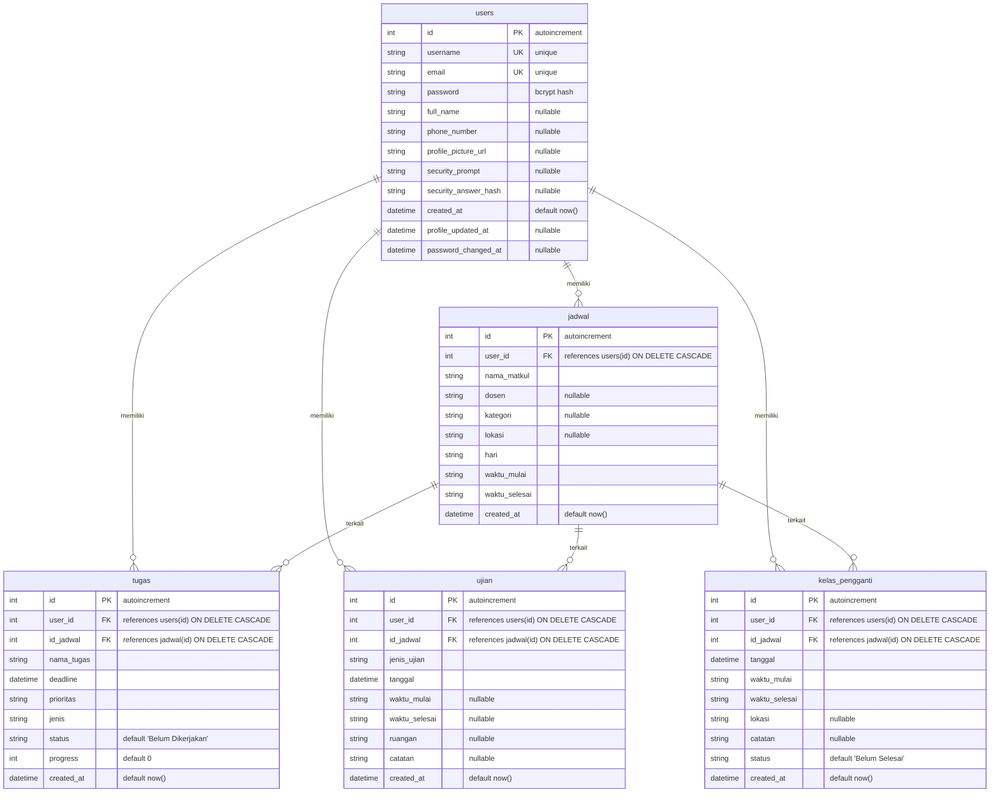

# Dokumentasi Sistem Database & Arsitektur Autentikasi — TrackerThings V2

Dokumen ini mendokumentasikan skema database, model data Prisma, relasi antar
tabel, arsitektur autentikasi hybrid, dan mitigasi keamanan Row Level Security
(RLS) pada **TrackerThings V2**.

---

## 1. Arsitektur Database & Model Hybrid

TrackerThings V2 mengadopsi arsitektur **Hybrid Data Access** yang memisahkan
jalur verifikasi kredensial sensitif dari jalur manipulasi data operasional:

```
┌────────────────────────────────────────────────────────────────────────┐
│                        KLIEN (Browser / Native iOS)                   │
└───────────────────┬────────────────────────────────┬───────────────────┘
                    │                                │
         (1) Submit Kredensial             (3) Operasional Data
        (Login Web / API iOS)             (Jadwal, Tugas, Ujian)
                    ▼                                ▼
┌──────────────────────────────────────┐ ┌───────────────────────────────┐
│        NEXT.JS TRUSTED SERVER        │ │     SUPABASE POSTGREST API    │
│  - app/actions/auth.ts               │ │  - utils/supabase/server.ts   │
│  - app/api/auth/login/route.ts       │ │  - Akses via anon/pub key     │
│  - lib/auth.ts & lib/prisma.ts       │ └──────────────┬────────────────┘
└───────────────────┬──────────────────┘                │
                    │ (2) Query Internal                │
            Koneksi Direct TCP                          │ PostgREST HTTP
             (DATABASE_URL)                             │ (RLS Terproteksi)
                    ▼                                   ▼
┌────────────────────────────────────────────────────────────────────────┐
│                  POSTGRESQL DATABASE (Supabase Managed)                │
│                                                                        │
│   ┌───────────────────────────┐      ┌─────────────────────────────┐   │
│   │       Tabel users         │      │  Tabel jadwal, tugas, dll.  │   │
│   │  - Akses: Trusted Prisma  │      │  - Akses: PostgREST & RLS   │   │
│   │  - RLS: Blokir Anon Key   │      │  - Terisolasi per User ID   │   │
│   └───────────────────────────┘      └─────────────────────────────┘   │
└────────────────────────────────────────────────────────────────────────┘
```

1. **Prisma ORM (`lib/prisma.ts`) — Trusted Server Engine**:
   - Terhubung langsung ke PostgreSQL melalui connection string privat
     (`DATABASE_URL`).
   - Dikhususkan untuk **verifikasi kredensial akun** (`users`), pembaruan
     profil pengguna, dan operasi transaksional yang membutuhkan integritas
     relasional tinggi.
   - Berjalan 100% di runtime server Node.js; connection string dan query tidak
     pernah terekspos ke klien.
2. **Supabase PostgREST Client (`utils/supabase/server.ts`)**:
   - Menggunakan `@supabase/ssr` untuk query data operasional akademik (jadwal,
     tugas, ujian, kelas pengganti).
   - Terikat pada kebijakan Row Level Security (RLS) PostgreSQL.

---

## 2. Entity-Relationship Diagram (ERD)



---

## 3. Spesifikasi Skema Database & Pemetaan Model Prisma

### 3.1 Model `User` (Tabel `users`)

Tabel utama penyimpan identitas akun dan kredensial pengguna.

| Nama Kolom (DB)        | Field Prisma         | Tipe Data PostgreSQL | Tipe Prisma | Constraint & Indeks  | Keterangan                                  |
| :--------------------- | :------------------- | :------------------- | :---------- | :------------------- | :------------------------------------------ |
| `id`                   | `id`                 | `SERIAL / INTEGER`   | `Int`       | `PRIMARY KEY`        | Identifikator unik pengguna                 |
| `username`             | `username`           | `VARCHAR / TEXT`     | `String`    | `UNIQUE`, `NOT NULL` | Username untuk autentikasi                  |
| `password`             | `password`           | `VARCHAR / TEXT`     | `String`    | `NOT NULL`           | Hash bcrypt (tidak boleh diekspos ke klien) |
| `email`                | `email`              | `VARCHAR / TEXT`     | `String`    | `UNIQUE`, `NOT NULL` | Alamat surel terdaftar                      |
| `full_name`            | `fullName`           | `TEXT`               | `String?`   | `NULLABLE`           | Nama lengkap mahasiswa                      |
| `phone_number`         | `phoneNumber`        | `TEXT`               | `String?`   | `NULLABLE`           | Nomor telepon kontak                        |
| `profile_picture_url`  | `profilePictureUrl`  | `TEXT`               | `String?`   | `NULLABLE`           | URL avatar profil                           |
| `security_prompt`      | `securityPrompt`     | `TEXT`               | `String?`   | `NULLABLE`           | Pertanyaan pemulihan sandi                  |
| `security_answer_hash` | `securityAnswerHash` | `TEXT`               | `String?`   | `NULLABLE`           | Hash jawaban pemulihan sandi                |
| `created_at`           | `createdAt`          | `TIMESTAMPTZ`        | `DateTime`  | `DEFAULT now()`      | Waktu pembuatan akun                        |
| `profile_updated_at`   | `profileUpdatedAt`   | `TIMESTAMPTZ`        | `DateTime?` | `NULLABLE`           | Waktu pembaruan profil                      |
| `password_changed_at`  | `passwordChangedAt`  | `TIMESTAMPTZ`        | `DateTime?` | `NULLABLE`           | Waktu penggantian sandi terakhir            |

_Catatan Relasi:_ Memiliki relasi 1-ke-banyak (`1:N`) dengan `jadwal`, `tugas`,
`ujian`, dan `kelas_pengganti` dengan aturan `ON DELETE CASCADE`.

---

### 3.2 Model `Jadwal` (Tabel `jadwal`)

Tabel master mata kuliah yang diambil mahasiswa (KRS).

| Nama Kolom (DB) | Field Prisma   | Tipe Data PostgreSQL | Tipe Prisma | Constraint & Indeks                     | Keterangan                   |
| :-------------- | :------------- | :------------------- | :---------- | :-------------------------------------- | :--------------------------- |
| `id`            | `id`           | `SERIAL / INTEGER`   | `Int`       | `PRIMARY KEY`                           | ID jadwal kuliah             |
| `user_id`       | `userId`       | `INTEGER`            | `Int`       | `FOREIGN KEY` $\rightarrow$ `users(id)` | Pemilik jadwal (`CASCADE`)   |
| `nama_matkul`   | `namaMatkul`   | `TEXT`               | `String`    | `NOT NULL`                              | Nama mata kuliah             |
| `dosen`         | `dosen`        | `TEXT`               | `String?`   | `NULLABLE`                              | Dosen pengampu               |
| `kategori`      | `kategori`     | `TEXT`               | `String?`   | `NULLABLE`                              | Wajib / Pilihan / Praktikum  |
| `lokasi`        | `lokasi`       | `TEXT`               | `String?`   | `NULLABLE`                              | Ruang kelas / laboratorium   |
| `hari`          | `hari`         | `TEXT`               | `String`    | `NOT NULL`                              | Hari kuliah (Senin - Sabtu)  |
| `waktu_mulai`   | `waktuMulai`   | `TEXT`               | `String`    | `NOT NULL`                              | Jam mulai (format `HH:mm`)   |
| `waktu_selesai` | `waktuSelesai` | `TEXT`               | `String`    | `NOT NULL`                              | Jam selesai (format `HH:mm`) |
| `created_at`    | `createdAt`    | `TIMESTAMPTZ`        | `DateTime`  | `DEFAULT now()`                         | Waktu penambahan jadwal      |

---

### 3.3 Model `Tugas` (Tabel `tugas`)

Tabel manajemen penugasan akademik dan pelacak progres.

| Nama Kolom (DB) | Field Prisma | Tipe Data PostgreSQL | Tipe Prisma | Constraint & Indeks                      | Keterangan                      |
| :-------------- | :----------- | :------------------- | :---------- | :--------------------------------------- | :------------------------------ |
| `id`            | `id`         | `SERIAL / INTEGER`   | `Int`       | `PRIMARY KEY`                            | ID tugas                        |
| `user_id`       | `userId`     | `INTEGER`            | `Int`       | `FOREIGN KEY` $\rightarrow$ `users(id)`  | Pemilik tugas (`CASCADE`)       |
| `id_jadwal`     | `idJadwal`   | `INTEGER`            | `Int`       | `FOREIGN KEY` $\rightarrow$ `jadwal(id)` | Mata kuliah terkait (`CASCADE`) |
| `nama_tugas`    | `namaTugas`  | `TEXT`               | `String`    | `NOT NULL`                               | Judul / deskripsi tugas         |
| `deadline`      | `deadline`   | `TIMESTAMPTZ`        | `DateTime`  | `NOT NULL`                               | Batas akhir pengumpulan         |
| `prioritas`     | `prioritas`  | `TEXT`               | `String`    | `NOT NULL`                               | Tinggi / Sedang / Rendah        |
| `jenis`         | `jenis`      | `TEXT`               | `String`    | `NOT NULL`                               | Individu / Kelompok             |
| `status`        | `status`     | `TEXT`               | `String`    | `DEFAULT 'Belum Dikerjakan'`             | Status penyelesaian             |
| `progress`      | `progress`   | `INTEGER`            | `Int`       | `DEFAULT 0`                              | Persentase kemajuan (0–100%)    |
| `created_at`    | `createdAt`  | `TIMESTAMPTZ`        | `DateTime`  | `DEFAULT now()`                          | Waktu pembuatan                 |

---

### 3.4 Model `Ujian` (Tabel `ujian`)

Tabel jadwal evaluasi akademik (UTS, UAS, Kuis).

| Nama Kolom (DB) | Field Prisma   | Tipe Data PostgreSQL | Tipe Prisma | Constraint & Indeks                      | Keterangan                      |
| :-------------- | :------------- | :------------------- | :---------- | :--------------------------------------- | :------------------------------ |
| `id`            | `id`           | `SERIAL / INTEGER`   | `Int`       | `PRIMARY KEY`                            | ID jadwal ujian                 |
| `user_id`       | `userId`       | `INTEGER`            | `Int`       | `FOREIGN KEY` $\rightarrow$ `users(id)`  | Mahasiswa peserta (`CASCADE`)   |
| `id_jadwal`     | `idJadwal`     | `INTEGER`            | `Int`       | `FOREIGN KEY` $\rightarrow$ `jadwal(id)` | Mata kuliah terkait (`CASCADE`) |
| `jenis_ujian`   | `jenisUjian`   | `TEXT`               | `String`    | `NOT NULL`                               | UTS / UAS / Kuis                |
| `tanggal`       | `tanggal`      | `TIMESTAMPTZ`        | `DateTime`  | `NOT NULL`                               | Tanggal pelaksanaan             |
| `waktu_mulai`   | `waktuMulai`   | `TEXT`               | `String?`   | `NULLABLE`                               | Jam mulai ujian                 |
| `waktu_selesai` | `waktuSelesai` | `TEXT`               | `String?`   | `NULLABLE`                               | Jam berakhir ujian              |
| `ruangan`       | `ruangan`      | `TEXT`               | `String?`   | `NULLABLE`                               | Gedung / ruang ujian            |
| `catatan`       | `catatan`      | `TEXT`               | `String?`   | `NULLABLE`                               | Petunjuk / materi ujian         |
| `created_at`    | `createdAt`    | `TIMESTAMPTZ`        | `DateTime`  | `DEFAULT now()`                          | Waktu pencatatan                |

---

### 3.5 Model `KelasPengganti` (Tabel `kelas_pengganti`)

Tabel sesi kuliah pengganti untuk jadwal reguler yang direskedul.

| Nama Kolom (DB) | Field Prisma   | Tipe Data PostgreSQL | Tipe Prisma | Constraint & Indeks                      | Keterangan                      |
| :-------------- | :------------- | :------------------- | :---------- | :--------------------------------------- | :------------------------------ |
| `id`            | `id`           | `SERIAL / INTEGER`   | `Int`       | `PRIMARY KEY`                            | ID kelas pengganti              |
| `user_id`       | `userId`       | `INTEGER`            | `Int`       | `FOREIGN KEY` $\rightarrow$ `users(id)`  | Mahasiswa terkait (`CASCADE`)   |
| `id_jadwal`     | `idJadwal`     | `INTEGER`            | `Int`       | `FOREIGN KEY` $\rightarrow$ `jadwal(id)` | Mata kuliah terkait (`CASCADE`) |
| `tanggal`       | `tanggal`      | `TIMESTAMPTZ`        | `DateTime`  | `NOT NULL`                               | Tanggal kuliah pengganti        |
| `waktu_mulai`   | `waktuMulai`   | `TEXT`               | `String`    | `NOT NULL`                               | Jam mulai sesi                  |
| `waktu_selesai` | `waktuSelesai` | `TEXT`               | `String`    | `NOT NULL`                               | Jam selesai sesi                |
| `lokasi`        | `lokasi`       | `TEXT`               | `String?`   | `NULLABLE`                               | Ruang kuliah pengganti          |
| `catatan`       | `catatan`      | `TEXT`               | `String?`   | `NULLABLE`                               | Alasan penggantian kelas        |
| `status`        | `status`       | `TEXT`               | `String`    | `DEFAULT 'Belum Selesai'`                | Status kehadiran                |
| `created_at`    | `createdAt`    | `TIMESTAMPTZ`        | `DateTime`  | `DEFAULT now()`                          | Waktu pembuatan                 |

---

## 4. Arsitektur Autentikasi & Hardening Kredensial

### 4.1 Pemisahan Verifikasi Kredensial ke Prisma

Untuk menutup risiko kebocoran tabel `users` via PostgREST publik, verifikasi
kredensial dialihkan secara penuh ke Prisma:

- **Server Action Web (`app/actions/auth.ts`)**: Mengeksekusi
  `prisma.user.findUnique({ where: { username }, select: { id: true, username: true, email: true, password: true } })`.
- **REST API Native iOS (`app/api/auth/login/route.ts`)**: Mengeksekusi
  `prisma.user.findUnique({ where: { username }, select: { ... } })`.

### 4.2 Siklus Hidup Password Hash

1. Password pengguna di-hash menggunakan algoritma **Bcrypt** (`bcryptjs`, cost
   factor 10) saat registrasi atau pembaruan password.
2. Nilai hash **hanya dibaca sementara di memori proses server** untuk
   dicocokkan menggunakan `verifyPassword(password, user.password)`.
3. Objek respons (`safeUser`), JWT payload, cookie session, dan log diagnostik
   **secara ketat dilarang** memuat field `password`.

### 4.3 Format Token & Manajemen Sesi

- **Token Signing**: Menggunakan pustaka `jose` dengan algoritma `HS256` dan
  masa berlaku 7 hari.
- **Payload JWT**:
  ```json
  {
    "userId": 1,
    "username": "mahasiswa",
    "email": "mahasiswa@kampus.ac.id",
    "role": "user",
    "iat": 1710000000,
    "exp": 1710604800
  }
  ```
- **Web Browser Client**: Sesi disimpan dalam HTTP Cookie `auth_session` bertipe
  `HttpOnly`, `SameSite=Lax`, dan `Secure` (pada production).
- **Native iOS Client**: Token JWT dikembalikan dalam respons JSON untuk
  disimpan di iOS Keychain dan dikirim melalui header
  `Authorization: Bearer <token>`.
- **Edge Middleware (`middleware.ts`)**: Memverifikasi token JWT secara mandiri
  di runtime Vercel Edge menggunakan `jwtVerify` tanpa dependensi ke Node
  runtime berat.

---

## 5. Keamanan Row Level Security (RLS) & Isolasi Role `anon`

1. **Prinsip Least Privilege**: Kunci publik `NEXT_PUBLIC_SUPABASE_ANON_KEY`
   merepresentasikan role PostgreSQL `anon`. Pada sistem database yang sehat,
   role `anon` **dilarang keras** memiliki hak `SELECT` terhadap tabel `users`.
2. **Mitigasi Serangan Ekstraksi**: Dengan mengalihkan login ke Prisma via
   `DATABASE_URL` privat, tabel `users` dapat sepenuhnya dilindungi oleh RLS di
   Supabase tanpa mengganggu fungsi login aplikasi.
3. **Pemisahan Error Database vs Kredensial**: Sistem membedakan kegagalan
   koneksi database (mengembalikan pesan gangguan server) dari kesalahan kata
   sandi (mengembalikan _"Username atau password salah"_), guna mencegah
   serangan timing dan username enumeration.

---

## 6. Persyaratan Environment & Konfigurasi Deployment

| Variabel                        | Deskripsi                                    | Sifat Rahasia      | Catatan Penggunaan                             |
| :------------------------------ | :------------------------------------------- | :----------------- | :--------------------------------------------- |
| `DATABASE_URL`                  | PostgreSQL connection string (direct/pooled) | **Sangat Rahasia** | Digunakan oleh Prisma ORM di server            |
| `JWT_SECRET`                    | Kunci simetris HS256 ($\ge 32$ karakter)     | **Sangat Rahasia** | Digunakan oleh `lib/auth.ts` & `middleware.ts` |
| `NEXT_PUBLIC_SUPABASE_URL`      | URL project Supabase                         | Publik             | Digunakan oleh Supabase client                 |
| `NEXT_PUBLIC_SUPABASE_ANON_KEY` | Kunci anon/publishable PostgREST             | Publik             | Digunakan oleh Supabase client operasional     |

> [!IMPORTANT] Saat deployment di Vercel, skrip build secara otomatis
> menjalankan `prisma generate && next build` (dikonfigurasi pada
> `package.json`). Pastikan variabel `DATABASE_URL` dan `JWT_SECRET` telah
> terisi pada _Vercel Project Settings_. s
