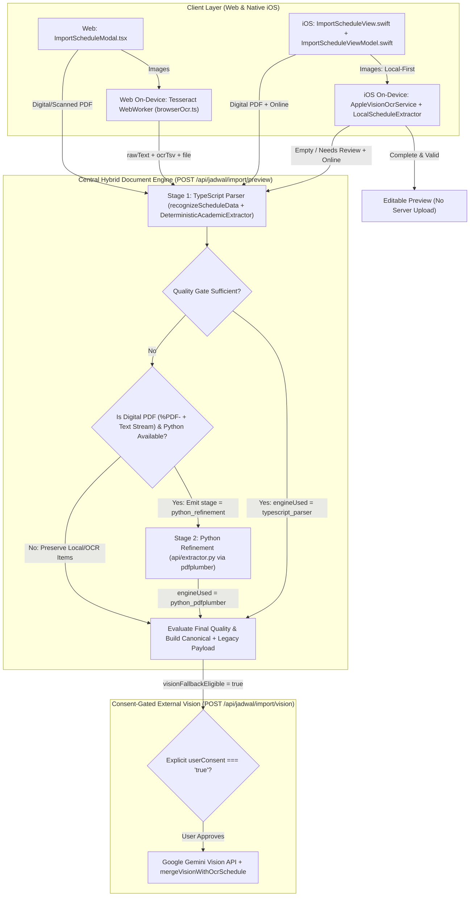

# TrackerThings V2 — Central Hybrid Document Engine & Processing Status UX

**Repository**: `riuusix/TrackerThings-V2`  
**Branch**: `main`  
**Primary Scope**: Schedule import from digital PDFs, scanned PDFs, and timetable photos across Web (`ImportScheduleModal.tsx`) and native iOS (`ImportScheduleViewModel.swift`).

---

## 1. Existing Architecture vs. Final Architecture

### 1.1 Existing Architecture (Pre-Audit Findings)

| Area | Existing Behavior | Root-Cause Issue |
|---|---|---|
| **Server Routing (`lib/intelligence/academicEngine.ts`)** | `AcademicHybridRouter.routeAndExtract()` called `selfHostedProvider.extract(input)` whenever deterministic extraction was insufficient, regardless of MIME type. | Non-PDF inputs (`image/jpeg`, `image/png`, `text/plain`) and scanned PDFs with empty digital text streams were forwarded to `SelfHostedServerProvider`, causing `api/extractor.py` (`pdfplumber`) to reject non-PDF headers or waste execution cycles. |
| **Preview Endpoint (`app/api/jadwal/import/preview/route.ts`)** | Checked `if (typeof rawTextParam === "string")` and skipped inspecting `formData.get("file")` when `rawText` was present; always invoked `hybridRouter.routeAndExtract()` even when TypeScript `recognizeScheduleData()` had already produced a complete schedule. | iOS multipart uploads sending both `file` and `rawText` lost their binary buffer & MIME metadata; simple documents needlessly invoked the hybrid router; responses lacked standardized `engineUsed`, `processingStage`, and `qualityStatus` metadata. |
| **Web Status UX (`components/ImportScheduleModal.tsx`)** | Displayed static file-type strings (`"Mengekstrak dokumen PDF..."`, `"Memetakan kolom jadwal..."`) and had no real-time stage transition or `AbortController` cancellation. | Users could not tell whether TypeScript initial parsing or Python `pdfplumber` table refinement was actively running, and cancelling an in-flight upload did not abort the request. |
| **iOS Local-First Flow (`ImportScheduleViewModel.swift`)** | Uploaded every photo to `dataService.previewScheduleImport` whenever `!isOffline` *before* evaluating `LocalScheduleExtractor.extract(from: ocr)`. | Even when on-device Apple Vision + `LocalScheduleExtractor` produced a complete, valid schedule, iOS still uploaded the photo to the server. |
| **iOS Model Defaults (`ScheduleImportModels.swift`)** | `ImportScheduleItem.init` and `init(from: decoder)` defaulted missing `hari` to `"Senin"`, `waktuMulai` to `"08:00"`, and `waktuSelesai` to `"10:00"`. | Silently fabricated schedule days and times when fields were missing from JSON responses, masking incomplete rows from manual review. |

### 1.2 Final Shared Hybrid Architecture

---

## 2. Localhost Runtime & Production Deployment Requirements

### 2.1 Localhost Development Runtime (`localhost`)
- **Node.js Runtime**: Runs the Next.js application (`POST /api/jadwal/import/preview` and `POST /api/jadwal/import/vision`) and executes the primary TypeScript parser (`lib/scheduleParser.ts` and `DeterministicAcademicExtractor`).
- **Python 3 Runtime (`pdfplumber`)**:
  - In local development (`VERCEL` unset), `SelfHostedServerProvider` verifies local Python readiness once via `python -c "import api.extractor; import pdfplumber"` (cached in-memory with an 8s timeout) or connects to `SELF_HOSTED_ML_URL` / `PYTHON_DEV_PORT` if a local FastAPI server is running.
  - When invoked for digital PDF refinement, it writes the PDF buffer to an isolated temporary file in `os.tmpdir()`, executes `python -m api.extractor <tempFile> --mime application/pdf`, parses the canonical JSON output, and unlinks the temporary file in a `finally` block.
  - If Python or `pdfplumber` is not installed locally, `SelfHostedServerProvider.isAvailable()` returns `false` and the router degrades gracefully to the TypeScript result with review warnings.

### 2.2 Vercel Production Runtime
- On Vercel (`VERCEL=1`), local `child_process` Python execution is strictly disabled (`checkLocalPythonAvailable()` returns `false`).
- `SelfHostedServerProvider` resolves the internal Python Serverless Function at `/api/python` (`api/index.py` + `api/extractor.py`, packaged via `pyproject.toml` and `requirements.txt`) and transmits digital PDFs via `multipart/form-data` to `POST /api/python/extract/academic` authenticated with `Authorization: Bearer <serviceKey>`.

---

## 3. Web & Native iOS Routing Rules and Response Contract

### 3.1 Routing Matrix by Document Type

| Input Type | Primary Path | Refinement Path | When `visionFallbackEligible` is `true` | Never Sent To |
|---|---|---|---|---|
| **Simple Digital PDF / Clean Text** | TypeScript `extractTextFromPdf` + `recognizeScheduleData` | None (TypeScript passes quality gate directly) | `false` | Python `pdfplumber` (skipped because TypeScript is already sufficient), Gemini Vision |
| **Complex Digital PDF (Multi-Column / Merged Cells)** | TypeScript `extractTextFromPdf` + `recognizeScheduleData` | Python `pdfplumber` (`api/extractor.py`) when TypeScript quality gate is insufficient | `true` only if post-Python result still has missing required fields | Browser/Server image OCR |
| **Scanned PDF (No Embedded Text Stream)** | `extractTextFromPdf` detects 0 characters -> returns HTTP 422 `SCANNED_PDF_NO_TEXT` | Eligible for explicit-consent Gemini Vision fallback | `true` | Python `pdfplumber` (`canProcessDocument` rejects empty text streams) |
| **Schedule Photo / Screenshot (Web)** | Browser Tesseract WASM (`runBrowserOcr`) or Server OCR (`extractOcrFromImage`) -> TypeScript `recognizeScheduleData` | Eligible for explicit-consent Gemini Vision fallback if incomplete | `true` when empty or `needsReview` exceeds threshold | Python `pdfplumber` (`canProcessDocument` rejects non-PDF MIME types) |
| **Schedule Photo / Screenshot (iOS)** | On-device `AppleVisionOcrService` -> `LocalScheduleExtractor.extract(from: ocr)` | If local result is empty or `needsReview`, uploads image + Apple Vision text/bboxes to `POST /api/jadwal/import/preview` | `true` when local + server parsing remains incomplete | Server upload when local Apple Vision extraction is already complete and valid |

### 3.2 Standardized Hybrid Response Metadata

Every response from `POST /api/jadwal/import/preview` and `POST /api/jadwal/import/vision` includes both camelCase (Web) and snake_case (iOS `Codable`) metadata fields alongside normalized `items`:

| Field (camelCase / snake_case) | Allowed Values | Purpose |
|---|---|---|
| `engineUsed` / `engine_used` | `"typescript_parser"`, `"python_pdfplumber"`, `"server_ocr"`, `"apple_vision_local"`, `"gemini_vision"` | Identifies the exact engine that produced the returned items. |
| `processingStage` / `processing_stage` | `"typescript_initial"`, `"python_refinement"`, `"ocr_extraction"`, `"vision_fallback"`, `"quality_gate_rejected"` | Identifies the pipeline stage reached. |
| `qualityStatus` / `quality_status` | `"sufficient"`, `"needs_review"`, `"insufficient"`, `"empty"` | Machine-readable quality gate verdict. |
| `warnings` | `string[]` | Human-readable explanations for any fields/rows requiring review. |
| `visionFallbackEligible` / `vision_fallback_eligible` | `boolean` | Indicates whether the UI should offer the optional Gemini Vision fallback card. |

---

## 4. Processing Status UX Mapping

Status copy is defined in the UI presentation layer (`components/ImportScheduleModal.tsx` on Web and `Sources/TrackerThings/ViewModels/ImportScheduleViewModel.swift` on iOS) and driven by confirmed processing stage events.

| Platform | Active Stage / Condition | Exact Status Message Displayed | Trigger Mechanism |
|---|---|---|---|
| **Web (`ImportScheduleModal.tsx`)** | Initial upload & TypeScript parsing (`stage === "typescript_initial"` or `"ocr_extraction"`) | `"Sistem TrackerThings sedang memproses jadwalmu…"` | Shown immediately when processing starts and maintained while TypeScript/OCR runs. |
| **Web (`ImportScheduleModal.tsx`)** | Python `pdfplumber` refinement (`stage === "python_refinement"` / `engine === "python_pdfplumber"`) | `"Mengompilasi dan mempertajam hasil analisismu…"` | Shown **only** when the server emits `{"type":"stage","stage":"python_refinement","engine":"python_pdfplumber"}` over the `X-Stream-Progress: 1` NDJSON stream after confirming digital PDF eligibility and Python runtime availability. |
| **Native iOS (`ImportScheduleViewModel.swift`)** | Local Apple Vision OCR on-device | `"Mengekstrak teks dengan Apple Vision di perangkat..."` | Shown during on-device `AppleVisionOcrService.shared.recognizeText`. |
| **Native iOS (`ImportScheduleViewModel.swift`)** | Server refinement fallback (when local Apple Vision is empty/incomplete or for digital PDFs) | `"Kami sedang memproses pertajaman analisismu, tunggu sebentar."` | Shown via `ImportScheduleViewModel.serverRefinementStatusMessage` before calling `dataService.previewScheduleImport`. |

---

## 5. Gemini Vision Consent & Data Integrity Invariants

1. **Zero Silent External Calls**: Neither `POST /api/jadwal/import/preview`, `AcademicHybridRouter`, nor `ImportScheduleViewModel` ever calls Google Gemini Vision automatically.
2. **Strict Server-Side Consent Enforcement**: `POST /api/jadwal/import/vision` validates `formData.get("userConsent") === "true" || "1"` and rejects any unconsented request with HTTP `400` (`CONSENT_REQUIRED`). `ExternalGenerativeProvider.extract()` likewise throws if `options?.userConsent !== true`.
3. **No Fabricated Defaults**: Missing `hari`, `waktuMulai`, or `waktuSelesai` fields are preserved as `""` (empty string) in both `bridgeCanonicalToLegacyItem()` (`lib/intelligence/academicEngine.ts`) and `ImportScheduleItem` (`Sources/TrackerThings/Models/ScheduleImportModels.swift`), automatically setting `needsReview = true` so the user is prompted to complete or review them before saving.

---

## 6. Verification Results & Required Environment Variables

### 6.1 Executed Verification Suites

| Suite / Command | Scope | Result |
|---|---|---|
| `node --test --experimental-strip-types tests/test_central_hybrid_document_engine.test.js` | All 12 scenarios from Section 7 (TS routing, Python localhost PDF refinement, Python unavailable fallback, scanned PDF rejection, image guard, Web status transitions, iOS local-first gate & server fallback message, Gemini consent gate, ban on `"Senin"`/`"08:00"` defaults) | **9/9 tests passed** (covering all 12 scenarios) |
| `node --test --experimental-strip-types tests/test_phase6_4_hybrid_extraction.test.js tests/test_academic_extraction_benchmark.test.js` | Layout-aware table extraction (`Jadwal_Kuliah_Arsitektur.pdf` 8 courses / 24 SKS), coordinate scaling, compound headers, live Vercel `/api/python` contract, 9-document benchmark manifest | **25/25 tests passed** |
| `node --test --experimental-strip-types tests/test_phase6_1_correction_and_parser.test.js tests/test_phase6_2_merge_and_evidence.test.js tests/test_phase6_3_real_document_e2e.test.js tests/test_ios_ocr_evidence_bridge.test.js tests/test_web_offline_ocr_and_quality_gates.test.js` | End-to-end OCR/Vision merge, correction diffs, iOS bounding-box bridge, offline quality gates | **39/39 tests passed** |
| `python -m pytest tests/test_academic_real_extraction.py tests/test_vercel_python_serverless.py -v` | Python `pdfplumber` digital/scanned/image extraction & FastAPI `/api/python` serverless contract | **12/12 tests passed** |
| `npx tsc --noEmit` | Full repository TypeScript typecheck | **0 errors** |
| `npx next build` | Production Next.js build | **Succeeded (Exit 0)** |

### 6.2 Required Environment Variable Names

> [!IMPORTANT]
> Only variable names are listed below. Never log, hardcode, or commit secret values.

- `DATABASE_URL` — PostgreSQL connection string for Prisma ORM.
- `JWT_SECRET` — Secret key for signing and verifying user session tokens.
- `GEMINI_API_KEY` (or `VISION_API_KEY`) — Google Gemini API key used strictly behind explicit user consent (`POST /api/jadwal/import/vision` and `POST /api/jadwal/import/verify`).
- `SELF_HOSTED_ML_KEY` (or `SERVICE_API_KEY`) — Internal server-to-server bearer token used between Next.js and the `/api/python` FastAPI extraction service.
- `SELF_HOSTED_ML_URL` *(optional)* — Custom base URL for the Python extraction microservice (auto-resolved from `VERCEL_PROJECT_PRODUCTION_URL` / `VERCEL_URL` / `NEXT_PUBLIC_APP_URL` in production, or local `python -m api.extractor` in development).

