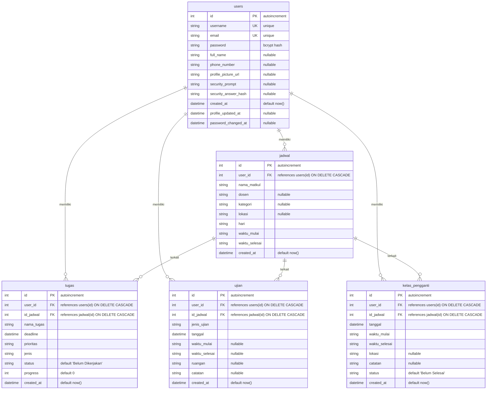

# Spesifikasi Skema Database — TrackerThings V2

Dokumen ini mendokumentasikan skema lengkap tabel database PostgreSQL yang dipetakan melalui model Prisma ORM ([`prisma/schema.prisma`](file:///C:/Users/Budy/Documents/TrackerThings-V2/prisma/schema.prisma)) pada TrackerThings V2.

---

## 1. Entity-Relationship Diagram (ERD)

---

## 2. Rincian Kamus Data (Data Dictionary)

### 2.1 Model `User` $\rightarrow$ Tabel `users`
Tabel penyimpan identitas akun pengguna dan kredensial autentikasi.

| Nama Kolom (DB) | Field Prisma | Tipe PostgreSQL | Tipe Prisma | Constraint / Nilai Default | Keterangan |
| :--- | :--- | :--- | :--- | :--- | :--- |
| `id` | `id` | `SERIAL / INTEGER` | `Int` | `PRIMARY KEY` | Identifikator unik pengguna |
| `username` | `username` | `VARCHAR / TEXT` | `String` | `UNIQUE`, `NOT NULL` | Username unik login |
| `password` | `password` | `VARCHAR / TEXT` | `String` | `NOT NULL` | Hash password Bcrypt (privat server) |
| `email` | `email` | `VARCHAR / TEXT` | `String` | `UNIQUE`, `NOT NULL` | Alamat surel terdaftar |
| `full_name` | `fullName` | `TEXT` | `String?` | `NULLABLE` | Nama lengkap mahasiswa |
| `phone_number` | `phoneNumber` | `TEXT` | `String?` | `NULLABLE` | Nomor telepon kontak |
| `profile_picture_url` | `profilePictureUrl`| `TEXT` | `String?` | `NULLABLE` | Tautan foto profil |
| `security_prompt` | `securityPrompt` | `TEXT` | `String?` | `NULLABLE` | Pertanyaan pemulihan sandi |
| `security_answer_hash`| `securityAnswerHash`| `TEXT` | `String?` | `NULLABLE` | Hash jawaban pemulihan sandi |
| `created_at` | `createdAt` | `TIMESTAMPTZ` | `DateTime` | `DEFAULT now()` | Waktu registrasi akun |
| `profile_updated_at` | `profileUpdatedAt` | `TIMESTAMPTZ` | `DateTime?`| `NULLABLE` | Waktu pembaruan profil terakhir |
| `password_changed_at`| `passwordChangedAt`| `TIMESTAMPTZ` | `DateTime?`| `NULLABLE` | Waktu penggantian sandi terakhir |

> [!NOTE]
> **Status Field `role`**: Kolom `role` **tidak dideklarasikan** pada `prisma/schema.prisma`. Untuk menjaga kompatibilitas payload token JWT tanpa berasumsi kolom ada di PostgreSQL fisik, aplikasi Next.js menggunakan fallback role `"user"`.

---

### 2.2 Model `Jadwal` $\rightarrow$ Tabel `jadwal`
Tabel master mata kuliah yang diambil mahasiswa (KRS).

| Nama Kolom (DB) | Field Prisma | Tipe PostgreSQL | Tipe Prisma | Constraint / Nilai Default | Keterangan |
| :--- | :--- | :--- | :--- | :--- | :--- |
| `id` | `id` | `SERIAL / INTEGER` | `Int` | `PRIMARY KEY` | ID jadwal mata kuliah |
| `user_id` | `userId` | `INTEGER` | `Int` | `FK` $\rightarrow$ `users(id)` (`CASCADE`) | Mahasiswa pemilik jadwal |
| `nama_matkul` | `namaMatkul` | `TEXT` | `String` | `NOT NULL` | Nama mata kuliah |
| `dosen` | `dosen` | `TEXT` | `String?` | `NULLABLE` | Nama dosen pengampu |
| `kategori` | `kategori` | `TEXT` | `String?` | `NULLABLE` | Kategori (Wajib / Pilihan / Praktikum) |
| `lokasi` | `lokasi` | `TEXT` | `String?` | `NULLABLE` | Ruang kuliah / laboratorium |
| `hari` | `hari` | `TEXT` | `String` | `NOT NULL` | Hari kuliah (Senin - Sabtu) |
| `waktu_mulai` | `waktuMulai` | `TEXT` | `String` | `NOT NULL` | Jam mulai kuliah (`HH:mm`) |
| `waktu_selesai` | `waktuSelesai` | `TEXT` | `String` | `NOT NULL` | Jam selesai kuliah (`HH:mm`) |
| `created_at` | `createdAt` | `TIMESTAMPTZ` | `DateTime` | `DEFAULT now()` | Waktu pembuatan data |

---

### 2.3 Model `Tugas` $\rightarrow$ Tabel `tugas`
Tabel pelacak tugas akademik, deadline, dan persentase progres.

| Nama Kolom (DB) | Field Prisma | Tipe PostgreSQL | Tipe Prisma | Constraint / Nilai Default | Keterangan |
| :--- | :--- | :--- | :--- | :--- | :--- |
| `id` | `id` | `SERIAL / INTEGER` | `Int` | `PRIMARY KEY` | ID tugas |
| `user_id` | `userId` | `INTEGER` | `Int` | `FK` $\rightarrow$ `users(id)` (`CASCADE`) | Mahasiswa pemilik tugas |
| `id_jadwal` | `idJadwal` | `INTEGER` | `Int` | `FK` $\rightarrow$ `jadwal(id)` (`CASCADE`)| Mata kuliah terkait |
| `nama_tugas` | `namaTugas` | `TEXT` | `String` | `NOT NULL` | Judul / deskripsi tugas |
| `deadline` | `deadline` | `TIMESTAMPTZ` | `DateTime` | `NOT NULL` | Tenggat waktu pengumpulan |
| `prioritas` | `prioritas` | `TEXT` | `String` | `NOT NULL` | Tingkat prioritas |
| `jenis` | `jenis` | `TEXT` | `String` | `NOT NULL` | Individu atau Kelompok |
| `status` | `status` | `TEXT` | `String` | `DEFAULT 'Belum Dikerjakan'` | Status pengerjaan |
| `progress` | `progress` | `INTEGER` | `Int` | `DEFAULT 0` | Persentase progres (0–100%) |
| `created_at` | `createdAt` | `TIMESTAMPTZ` | `DateTime` | `DEFAULT now()` | Waktu pembuatan tugas |

---

### 2.4 Model `Ujian` $\rightarrow$ Tabel `ujian`
Tabel penjadwalan evaluasi akademik (UTS, UAS, Kuis).

| Nama Kolom (DB) | Field Prisma | Tipe PostgreSQL | Tipe Prisma | Constraint / Nilai Default | Keterangan |
| :--- | :--- | :--- | :--- | :--- | :--- |
| `id` | `id` | `SERIAL / INTEGER` | `Int` | `PRIMARY KEY` | ID jadwal ujian |
| `user_id` | `userId` | `INTEGER` | `Int` | `FK` $\rightarrow$ `users(id)` (`CASCADE`) | Mahasiswa peserta ujian |
| `id_jadwal` | `idJadwal` | `INTEGER` | `Int` | `FK` $\rightarrow$ `jadwal(id)` (`CASCADE`)| Mata kuliah terkait |
| `jenis_ujian` | `jenisUjian` | `TEXT` | `String` | `NOT NULL` | UTS / UAS / Kuis |
| `tanggal` | `tanggal` | `TIMESTAMPTZ` | `DateTime` | `NOT NULL` | Tanggal ujian |
| `waktu_mulai` | `waktuMulai` | `TEXT` | `String?` | `NULLABLE` | Jam mulai pelaksanaan |
| `waktu_selesai` | `waktuSelesai` | `TEXT` | `String?` | `NULLABLE` | Jam selesai pelaksanaan |
| `ruangan` | `ruangan` | `TEXT` | `String?` | `NULLABLE` | Lokasi / ruang ujian |
| `catatan` | `catatan` | `TEXT` | `String?` | `NULLABLE` | Catatan tambahan |
| `created_at` | `createdAt` | `TIMESTAMPTZ` | `DateTime` | `DEFAULT now()` | Waktu pencatatan ujian |

---

### 2.5 Model `KelasPengganti` $\rightarrow$ Tabel `kelas_pengganti`
Tabel sesi perkuliahan pengganti untuk jadwal yang direskedul.

| Nama Kolom (DB) | Field Prisma | Tipe PostgreSQL | Tipe Prisma | Constraint / Nilai Default | Keterangan |
| :--- | :--- | :--- | :--- | :--- | :--- |
| `id` | `id` | `SERIAL / INTEGER` | `Int` | `PRIMARY KEY` | ID sesi kelas pengganti |
| `user_id` | `userId` | `INTEGER` | `Int` | `FK` $\rightarrow$ `users(id)` (`CASCADE`) | Mahasiswa peserta sesi |
| `id_jadwal` | `idJadwal` | `INTEGER` | `Int` | `FK` $\rightarrow$ `jadwal(id)` (`CASCADE`)| Mata kuliah terkait |
| `tanggal` | `tanggal` | `TIMESTAMPTZ` | `DateTime` | `NOT NULL` | Tanggal kelas pengganti |
| `waktu_mulai` | `waktuMulai` | `TEXT` | `String` | `NOT NULL` | Jam mulai kelas pengganti |
| `waktu_selesai` | `waktuSelesai` | `TEXT` | `String` | `NOT NULL` | Jam selesai kelas pengganti |
| `lokasi` | `lokasi` | `TEXT` | `String?` | `NULLABLE` | Ruang perkuliahan |
| `catatan` | `catatan` | `TEXT` | `String?` | `NULLABLE` | Alasan penggantian kelas |
| `status` | `status` | `TEXT` | `String` | `DEFAULT 'Belum Selesai'`| Status kehadiran sesi |
| `created_at` | `createdAt` | `TIMESTAMPTZ` | `DateTime` | `DEFAULT now()` | Waktu pencatatan |

---

## 3. Tabel Tambahan di Database Cloud (Hasil Audit Terverifikasi 2026-10-12)

Selain 5 model yang saat ini terdefinisi di `prisma/schema.prisma`, audit database cloud menemukan 3 tabel operasional tambahan di PostgreSQL `public` schema:

### 3.1 Tabel `announcements`
Menyimpan pengumuman admin sistem kepada pengguna aplikasi.
- Kolom:
  - `id`: `BIGINT` (`int8`), PRIMARY KEY, NOT NULL
  - `title`: `VARCHAR`, NOT NULL
  - `content`: `TEXT`, NOT NULL
  - `is_active`: `BOOLEAN`, NOT NULL
  - `created_at`: `TIMESTAMPTZ`, NULLABLE

### 3.2 Tabel `settings`
Menyimpan konfigurasi key-value sistem (misal batas sesi, maintenance mode).
- Kolom:
  - `setting_key`: `VARCHAR`, PRIMARY KEY, NOT NULL
  - `setting_value`: `TEXT`, NULLABLE

### 3.3 Tabel `admin_logs`
Menyimpan audit trail aksi administratif pengelola platform.
- Kolom:
  - `id`: `BIGINT` (`int8`), PRIMARY KEY, NOT NULL
  - `timestamp`: `TIMESTAMPTZ`, NULLABLE
  - `admin_username`: `VARCHAR`, NOT NULL
  - `action_type`: `VARCHAR`, NOT NULL
  - `action_description`: `TEXT`, NOT NULL

### 3.4 Kolom Tambahan pada Tabel Inti yang Belum Dimodelkan di Prisma:
- Tabel `jadwal`: Kolom `sks` (`INTEGER`, nullable).
- Tabel `users`: Kolom `role` (`VARCHAR`, default `'user'`), `new_password_hash` (`VARCHAR`), `reset_token` (`VARCHAR`), `token_expires_at` (`TIMESTAMP`).
- Tabel `auth.users`: Terverifikasi ada (`auth_users_exists = true`) pada instance Supabase Cloud.

